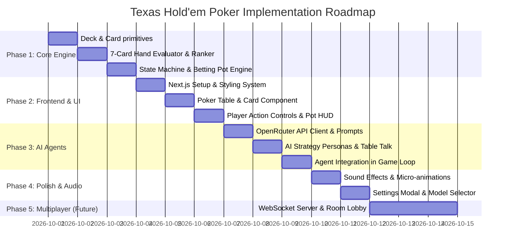

# Texas Hold'em Poker Web Game with AI Agents & Multiplayer

## Technical Specification & Implementation Plan

---

### 1. Executive Summary & Vision

A modern, responsive full-stack Texas Hold'em Poker web application built with **Next.js (App Router)** and **React**. The application features an interactive poker table with rich visuals, chip management, and authentic tournament/cash game mechanics.

- **Phase 1 (Single Player vs AI Agents):** Players can practice against one or more AI opponents powered by the **OpenRouter API**. Each AI agent possesses a unique poker personality and strategy (e.g., _Tight-Aggressive Shark_, _Loose-Aggressive Maniac_, _Analytical GTO Professor_, _Unpredictable Calling Station_). The AI analyzes table context, pot odds, position, and opponent action history to make realistic decisions and provide immersive table banter.
- **Phase 2 (Multiplayer with Hybrid AI):** Real-time multiplayer rooms via WebSockets, allowing human players and AI bots to compete at the same table with authoritative server-side validation.

---

### 2. System Architecture

```mermaid
graph TD
    subgraph Client [Browser / React Frontend]
        UI[Poker Table UI & Felt View]
        Controls[Betting Controls & Action Bar]
        HUD[Hand Strength & Pot Odds HUD]
        Audio[Sound & Web Audio Engine]
        State[Client State & Animations]
    end

    subgraph Backend [Next.js Fullstack Server]
        API_Game[/api/poker/action - Game Engine Route]
        API_AI[/api/ai/decide - OpenRouter Proxy]
        API_Models[/api/ai/models - Model List]
        WS[WebSocket Server / Socket.IO (Phase 2)]
    end

    subgraph CoreEngine [Poker Engine Library]
        Deck[Deck & Card Shuffler]
        Evaluator[7-Card Hand Evaluator]
        StateMachine[Texas Hold'em State Machine]
        PotManager[Pot & Side Pot Calculator]
    end

    subgraph AI [OpenRouter LLM Services]
        OR[OpenRouter API]
        Claude[Claude 3.5 Sonnet]
        Llama[Llama 3.3 70B]
        GPT[GPT-4o Mini / Gemini]
        DeepSeek[DeepSeek V3 / R1]
    end

    UI --> State
    Controls --> State
    State --> API_Game
    API_Game --> CoreEngine
    CoreEngine --> API_Game
    API_Game --> API_AI
    API_AI --> OR
    OR --> Claude
    OR --> Llama
    OR --> GPT
    OR --> DeepSeek
```

---

### 3. Detailed Component Breakdown

#### 3.1. Core Texas Hold'em Engine (`lib/poker/`)

The core game logic is designed as a standalone, deterministic TypeScript library usable on both server and client:

1. **Card & Deck Management (`deck.ts`):**
   - 52-card standard deck (Suits: `♠`, `♥`, `♦`, `♣`; Ranks: `2` through `A`).
   - Cryptographically secure Fisher-Yates shuffle.
   - Card representations with numeric rank (`2..14`) and suit indices for bitwise operations.

2. **Hand Evaluator (`evaluator.ts`):**
   - Fast 7-card evaluator determining the best 5-card combination from 2 hole cards + 5 community cards.
   - Evaluates hand tiers:
     1. Royal Flush
     2. Straight Flush
     3. Four of a Kind (Quads)
     4. Full House
     5. Flush
     6. Straight
     7. Three of a Kind (Set/Trips)
     8. Two Pair
     9. One Pair
     10. High Card
   - Exact tie-breaking with kickers and split pot handling.

3. **Game State Machine (`game.ts`):**
   - Table phases:
     - `WAITING_FOR_PLAYERS`
     - `DEALING_HOLE_CARDS`
     - `PRE_FLOP` (Small blind, big blind posted, action starts UTG)
     - `FLOP` (3 community cards revealed)
     - `TURN` (4th community card revealed)
     - `RIVER` (5th community card revealed)
     - `SHOWDOWN` (Hands revealed, winning hand calculated)
     - `HAND_COMPLETE` (Chips distributed, dealer button moves clockwise)
   - Valid Action Matrix:
     - `FOLD`: Player forfeits the hand and current wager.
     - `CHECK`: Pass action if current bet matches player's committed bet.
     - `CALL`: Match the current highest bet.
     - `BET`: Make the first wager in a betting round (min bet = big blind).
     - `RAISE`: Increase the current bet (min raise = previous raise delta).
     - `ALL_IN`: Wager all remaining chips.
   - Turn Timeout: Configurable 20–30s countdown for player turns with automatic check/fold fallback.

4. **Pot & Side Pot Resolution (`pot.ts`):**
   - Handles multi-way all-in scenarios with accurate main pot and incremental side pots.
   - Tracks each player's contribution per betting round to avoid chip leakage.

---

#### 3.2. AI Agent System (`lib/ai/`)

Each AI agent operates as an independent poker player with its own context, strategy, and risk tolerance:

1. **Predefined Strategy Personas:**

| Persona                 | Archetype                       | Pre-Flop Range                                           | Post-Flop Style                                           | Bluff Frequency       | Chat Persona                                            |
| ----------------------- | ------------------------------- | -------------------------------------------------------- | --------------------------------------------------------- | --------------------- | ------------------------------------------------------- |
| **Victor "The Shark"**  | Tight-Aggressive (TAG)          | Top 15% hands (Pairs, High Broadways, Suited Connectors) | Relentless value-betting, calculates pot odds             | Moderate / calculated | Cold, professional, subtle psychological jabs           |
| **Rex "The Gambler"**   | Loose-Aggressive (LAG)          | Wide 40%+ hands                                          | High pressure, frequent check-raises, attacks weakness    | High                  | Bold, swaggering, talks trash, risk-seeker              |
| **Old Man Arthur**      | Tight-Passive (Nit / Rock)      | Premium hands only (AA-TT, AK)                           | Checks and calls when ahead, folds to heavy raises        | Very Rare             | Grumpy, cautious, complains about bad beats             |
| **Daisy "The Station"** | Loose-Passive (Calling Station) | Any two cards                                            | Rarely folds pairs or gutshot draws                       | Extremely Low         | Friendly, chatty, optimistic, "just wants to see cards" |
| **Dr. Turing**          | GTO / Analytical                | Math-optimal frequencies                                 | Bet sizing mapped to pot (33%, 66%, pot), balanced ranges | Balanced              | Statistical commentary, calculates exact pot odds       |

2. **Table Context Serialization for LLM Prompt:**
   The AI receives a structured prompt containing:
   - **Agent Identity & Style:** Persona instructions and playing rules.
   - **Private Information:** AI's hole cards (e.g., `["A♠", "K♥"]`).
   - **Public Table State:**
     - Community cards (e.g., `["10♦", "J♠", "Q♣"]`)
     - Current phase (`FLOP`), pot size, current bet to call, minimum raise.
     - Chip stacks and table positions (Dealer Button, SB, BB, UTG, etc.).
     - History of actions in the current hand (e.g., _"Player 1 bets $50, Player 2 calls $50"_).
     - Pot odds calculation helper (e.g., _"Need $50 to win $200 = 20% required equity"_).
   - **JSON Schema Output:**
     ```json
     {
       "action": "RAISE",
       "amount": 150,
       "confidence": 0.85,
       "internal_reasoning": "Holding top pair top kicker with gutshot broadway draw on a wet board; charging drawing hands.",
       "table_talk": "You'll have to pay to see the turn, my friend."
     }
     ```

3. **OpenRouter Integration & Model Support:**
   - Supported models (user configurable):
     - `anthropic/claude-3.5-sonnet` (Elite strategic thinking & banter)
     - `meta-llama/llama-3.3-70b-instruct` (Fast, cost-effective, great reasoning)
     - `google/gemini-2.5-flash` / `google/gemini-flash-1.5` (Ultra-low latency)
     - `openai/gpt-4o-mini` (Budget-friendly & robust JSON adherence)
     - `deepseek/deepseek-chat` (High value reasoning)
   - In-memory conversation/hand memory: Maintains context of previous hands against the player to adapt play (e.g., noting if the player is a chronic bluffer).
   - Robust Fallback System: If an API timeout or schema parsing error occurs, the engine automatically falls back to an algorithmic rule-based action (Check/Fold or Min-Call) so the game never hangs.

---

#### 3.3. Frontend & Visual Design System

1. **Aesthetic & Theme:**
   - **Casino Royale Dark Theme:** Deep emerald/felt green table (`#0b3823`) with stitched gold leather rail trim and dark ambient vignette.
   - **Cards:** Crisp vector SVG playing cards with micro-animations (slide out from shoe, 3D flip reveal on flop/turn/river, smooth fold fade-out).
   - **Chips:** Color-coded 3D-styled poker chip stacks ($1, $5, $25, $100, $500, $1,000) that slide into the pot.
   - **Player Pods:**
     - Avatar with active turn highlight (glowing gold pulse ring + radial countdown timer).
     - Status chips (Dealer button `D`, Small Blind `SB`, Big Blind `BB`).
     - Real-time speech bubbles displaying the AI agent's table banter.
     - Hand result banner with card highlighting (e.g., "FLUSH, ACE HIGH").

2. **Player Controls & Assistance:**
   - Action bar with quick-bet shortcuts: `Min`, `2.5x BB`, `3x BB`, `1/2 Pot`, `3/4 Pot`, `Pot`, `All-in`.
   - Smooth bet slider with manual numeric input.
   - **Live Hand Strength & Pot Odds HUD:**
     - Displays current best 5-card hand rank for beginner/intermediate guidance.
     - Shows current pot odds (%) to help players make informed calls.

3. **Audio & Sound Effects (Web Audio API / Synthesized):**
   - Card deal swish, card flip snap, chip clink / slide sounds, check knock sound, victory chime.
   - Toggleable sound effects and volume slider in settings.

4. **Settings & Customization:**
   - OpenRouter API Key input (stored securely in `localStorage` or server `.env.local`).
   - Model selection dropdown with latency/pricing tier info.
   - Table configuration: Number of AI players (1 to 5), Starting stack ($500 to $10,000), Blind structure ($5/$10, $10/$20, $25/$50).

---

### 4. Implementation Plan & Milestones



#### Milestone Breakdown:

- **Milestone 1: Pure TypeScript Texas Hold'em Core Engine**
  - Implement cards, deck, shuffle, and 7-card evaluator with unit tests.
  - Implement full betting state machine: blinds, pre-flop, flop, turn, river, showdown, and side pots.

- **Milestone 2: Next.js Setup & High-Fidelity Poker Table UI**
  - Scaffold Next.js app with Tailwind/CSS design system.
  - Build interactive table layout: player seats, dealer button, pot display, chip stacks, community card board.
  - Action bar with Fold, Check, Call, Bet/Raise slider, and quick bet presets.
  - Animated card dealing and chip movements.

- **Milestone 3: OpenRouter AI Agent Integration**
  - Next.js API routes (`/api/ai/decide`, `/api/ai/models`).
  - System prompts with poker strategies (_Shark_, _Gambler_, _Rock_, _Calling Station_, _Professor_).
  - Structured JSON response parsing with validation and automated fallback mechanisms.
  - Speech bubbles for live AI banter and thoughts display.

- **Milestone 4: Sound, Hand Analyzer HUD & Settings**
  - Web Audio sound effects for deals, bets, checks, and wins.
  - Real-time hand strength helper and pot odds indicator.
  - Settings modal for API key, model selection, and table customization.

- **Milestone 5: Multiplayer Architecture (Phase 2)**
  - WebSocket room lobby, shared state synchronization, and hidden-card security enforcement.

---

### 5. Verification & Testing Strategy

1. **Engine Verification:**
   - Unit tests for hand evaluation (testing all 10 hand rankings, kickers, and split pots).
   - Side pot calculation tests with multi-way all-in scenarios.
2. **AI Action Verification:**
   - Test LLM responses against valid actions in each phase.
   - Verify fallback mechanism triggers smoothly on invalid outputs or network dropouts.
3. **Browser Testing:**
   - Full gameplay loop validation: start game, post blinds, deal cards, player actions, AI decisions, showdown, and pot distribution.
   - Responsive layout checks for desktop and tablet screens.
